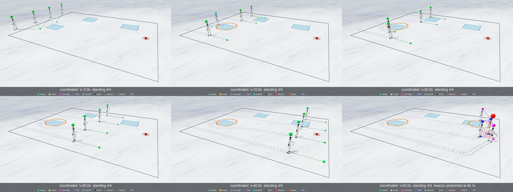

# Fleet track

A team of Unitree G1s runs an avalanche search across a snowfield with hidden
ice. Built on the Newton track (read `NEWTON_TRACK.md` first for the engine, the
policy and the friction results this depends on). Added 2026-11-26/27. Code is in
`newton_track/fleet_*.py`.

## The task

Someone is buried in a 12 x 14 m debris field with a transceiver beacon. Four
robots line up along the bottom edge and must:

1. sweep the field so no strip is left unsearched (transceiver range 2 m);
2. pinpoint the beacon once any of them picks up its signal;
3. assemble a dig team of three at the burial point.

Three patches of ice lie under the snow, about 5 % of the field, and nobody can
see them. This policy cannot walk on ice: the single-robot sweep puts its limit
at friction 0.15 to 0.2, the snow here is 0.4 and the ice 0.08.



One mission, seed 25, a frame every ten seconds. At 10 s the second robot from
the left feels ice and backs off (cyan), and the patch it reported gets an
orange keep-out ring that the others walk round. At 46.1 s the beacon is
pinpointed and three robots close in on it. This is one seed and an
illustration, not a measurement; the results are in the tables below.

## How the team is built

**Each robot is its own agent.** It knows its own pose, its own transceiver
reading and what arrived in its inbox, and it decides its own walking command.
There is no central planner. Agents agree on lanes and dig positions because
they all apply the same deterministic rule to the same shared roster.

**They share a broadcast bus** with five message types:

| message | meaning |
|---|---|
| `POSE` | heartbeat at 5 Hz: who I am, where, what I am doing, which dig slot I claim, and what I know of the team, the ice and the beacon, so news crosses more than one hop |
| `DOWN` | I fell, here |
| `HAZARD` | there is ice here |
| `SIGNAL` | my transceiver reads the beacon: estimated position and range |
| `FOUND` | pinpointed: dig here |

**What coordination consists of:**

- Lanes are an equal split of the field among robots level with the front, left
  to right. When one goes down, or falls more than 3 m behind, the rest close up.
- The line stays abreast: whoever is ahead of the pack slows down.
- A hazard one robot finds is routed around by all of them.
- On a signal, the robot with the shortest range pinpoints. The others each claim
  one of twelve dig slots around it and keep the claim; a taken slot blocks its
  two neighbours.

**Each robot also has a slip reflex** (`fleet_reflex.py`). It estimates how much
sideways grip the ground is giving from its own motion, confirms ice when a
planted foot slides while that grip is low, stops, backs out onto snow, and
reports the ice edge. It reads nothing about the ground. Measured alone on 128
paired encounters (seeds 300-315): 126 falls without it, 2 with it, and no alarm
in 79.6 robot-minutes on plain snow. That pools four approaches, three of them
easy. Square-on at sweep speed, the hard one, it falls 6 times in 256. See "The
reflex, looked at harder" below for what it does not handle.

**The ablation.** `--mode independent` is the same robots, sensors, controller,
reflex and ice with the bus switched off. Each robot sweeps the lane it started
in and reacts only to what it senses itself. Both modes run on the same seeds.

## Running it

`npy` is `~/projects/newton-sandbox/.venv/bin/python`, as in `NEWTON_TRACK.md`.

```bash
npy newton_track/test_fleet_route.py                       # planner geometry, 1 s
npy newton_track/fleet_sim.py                              # measured snow and ice friction
npy newton_track/fleet_reflex.py                           # reflex tables (slow)
npy newton_track/fleet_search.py --seeds 20 --seed-start 60 --reflex   # 25 min
npy newton_track/fleet_search.py --film 25 --reflex        # one mission to demo/, needs a display
npy newton_track/fleet_comms.py --help                     # radio and team-size studies (hours)
npy newton_track/report.py                                 # regenerate the tables below
```

| File | What it is |
|---|---|
| `fleet_sim.py` | N policy-driven G1s in one MuJoCo-CPU scene on snow with ice patches. About 230 control ticks per second for four robots. No decisions. |
| `g1_collision.py` | 29 collision-only primitives per robot, so a fallen robot lies on the snow. Upright walking is bit-identical with and without them. |
| `fleet_reflex.py` | The slip reflex and its own evaluation. |
| `fleet_flush.py` | Flush-ice and sweep-speed study: six cells of full missions, with controls. |
| `fleet_search.py` | The mission: agents, bus, path planner, scoring, paired evaluation. |
| `test_fleet_route.py` | Ten geometry cases for the planner, each a shape that broke an earlier version in a real mission. |
| `fleet_comms.py` | `LossyBus` (packet loss, range limit), candidate agent variants, and the radio and team-size studies. |
| `film_fleet.py` | Wide-shot renderer: snow, footprints, the beacon, mapped hazards, radio links, role markers. Rendering only. |

## Results

Scoring. **Located**: a robot declared the burial point within 1 m of the truth.
**Assembled**: three robots standing, holding, within 1.7 m of the true beacon
for a full second. Three is fixed, so a team that has lost two of four cannot
assemble. A mission has 100 simulated seconds.

Which seeds count. The planner was debugged on seeds 0-39 (and looked at on 40
and 42), so those cannot score it honestly. **Seeds 60-79 are the result.** The
other two sets are shown so the gap between tuned-on and untouched is visible.

<!-- BEGIN GENERATED (newton_track/report.py, fleet section) -->

### Fleet search, seeds 60-79 (held out: nothing was tuned on these)

4 robots, snow mu 0.4, ice mu 0.08, three ice patches. Every row is the same seeds.

| slip reflex | radio | beacon located | dig team assembled | robots lost per mission | median s to locate | median s to assemble |
|---|---|---|---|---|---|---|
| off | on | 19/20 | 11/20 | 1.45 | 25.7 | 28.9 |
| off | off | 18/20 | 0/20 | 1.55 | 24.9 | - |
| on | on | 20/20 | 20/20 | 0.05 | 37.0 | 47.3 |
| on | off | 20/20 | 0/20 | 0.10 | 25.7 | - |

- Reflex off, radio on, did not assemble: seed 64 (lost 2), seed 65 (lost 2), seed 66 (lost 2), seed 68 (lost 2), seed 75 (lost 3), seed 76 (lost 2), seed 77 (lost 2), seed 78 (lost 2), seed 79 (lost 2).

### Fleet search, seeds 0-19 (used to debug the planner)

4 robots, snow mu 0.4, ice mu 0.08, three ice patches. Every row is the same seeds.

| slip reflex | radio | beacon located | dig team assembled | robots lost per mission | median s to locate | median s to assemble |
|---|---|---|---|---|---|---|
| on | on | 20/20 | 20/20 | 0.05 | 38.8 | 45.3 |
| on | off | 18/20 | 0/20 | 0.25 | 28.1 | - |


### Fleet search, seeds 20-39 (used to debug the planner)

4 robots, snow mu 0.4, ice mu 0.08, three ice patches. Every row is the same seeds.

| slip reflex | radio | beacon located | dig team assembled | robots lost per mission | median s to locate | median s to assemble |
|---|---|---|---|---|---|---|
| on | on | 19/20 | 19/20 | 0.15 | 36.6 | 45.6 |
| on | off | 20/20 | 1/20 | 0.20 | 30.1 | 59.6 |

- Reflex on, radio on, did not assemble: seed 30 (not located).

<!-- END GENERATED -->

### Reading the numbers

- **With the reflex and the radio, the team did the whole job on all twenty
  held-out seeds**, losing one robot in twenty missions.
- **The reflex is what makes the task possible.** Without it the team loses 1.45
  robots a mission and assembles 11 times in 20. Every one of the nine failures
  had lost two or more robots, and three are needed to dig. Coordination does
  not protect against ice on its own (1.45 lost with the radio, 1.55 without):
  a team with no reflex learns about a patch by losing a robot to it.
- **"Assembled 0/20 with the radio off" is true almost by construction, and
  should not be quoted as the size of the coordination effect.** Without a radio
  a robot only walks to the beacon if its own transceiver hears it. The range is
  2 m and the lanes are 3 m apart, so three robots gathering needs luck the
  layout does not offer (it happened once in 80 missions). The row shows that
  the task needs communication. It does not measure how good the coordination is.
- **"Located" is the comparison a lone robot can win**, and with the reflex on
  it is 20/20 either way on the held-out seeds. Without the reflex the radio is
  worth one beacon in twenty (19 vs 18): a robot fell and the line closed up
  over its lane.
- **Coordination costs time.** Median time to locate is 37 s with the radio
  against 26 s without, because the line waits for its slowest member and backs
  off ice together.
- **The debug sets score about the same as the held-out set** (20/20 and 19/20
  assembled), which is some evidence the final planner is not fitted to them.
  It is not proof: three planner versions were thrown away on these seeds.
- **Seed 30 is a hole in the sweep, and it is a class, not a one-off.** Radio
  and reflex on, nobody lost, beacon never located. One robot fell behind after
  two reflex stops, the other three re-split the field into lanes 4 m apart,
  which is exactly twice the 2 m transceiver range, and the beacon sat on the
  seam, 2.19 m from the nearest robot. The straggler walked straight up a
  neighbour's strip. All four parked at the top and the mission ended at 72.5 s
  with 27.5 s unused. See "Relaying, and the hole in the sweep" below.

## How much radio, and how many robots

Two studies by a separate agent (`fleet_comms.py`), 324 missions on a frozen
copy of the planner commit, seeds 40-51, twelve per cell, the same seeds in
every cell. `LossyBus` drops each message to each receiver independently with
probability p, or delivers only within a range. Twelve seeds is few: read
differences of one mission as nothing.

<!-- BEGIN GENERATED (newton_track/report.py, studies section) -->

### Radio study (4 robots, slip reflex on, seeds 40-51, commit 928f08f)

Medians are over the missions that assembled.

| cell | located | assembled | robots lost per mission | median s to assemble | sweep time in the wrong lane |
|---|---|---|---|---|---|
| loss 0 | 12/12 | 11/12 | 0.33 | 25.5 | 0 % |
| loss 0.5 | 12/12 | 12/12 | 0.17 | 27.0 | 2 % |
| loss 0.8 | 12/12 | 11/12 | 0.25 | 28.2 | 47 % |
| loss 0.95 | 8/12 | 8/12 | 0.08 | 31.4 | 88 % |
| range 5 m | 12/12 | 12/12 | 0.00 | 25.3 | 59 % |
| range 3 m | 12/12 | 5/12 | 0.17 | 21.2 | 77 % |
| independent | 12/12 | 0/12 | 0.08 | - | - |

Candidate agent changes, same seeds and radio:

| cell | located | assembled | robots lost per mission | median s to assemble | sweep time in the wrong lane |
|---|---|---|---|---|---|
| loss 0.8 +memory | 12/12 | 12/12 | 0.08 | 28.3 | 5 % |
| loss 0.8 +patient | 12/12 | 12/12 | 0.00 | 28.4 | 5 % |
| range 5 m +relay | 12/12 | 12/12 | 0.08 | 26.4 | 2 % |
| loss 0.95 +memory | 12/12 | 11/12 | 0.33 | 30.4 | 44 % |
| loss 0.95 +patient | 12/12 | 12/12 | 0.33 | 29.5 | 40 % |
| range 3 m +relay | 12/12 | 11/12 | 0.00 | 26.4 | 25 % |
| loss 0 +relay | 12/12 | 11/12 | 0.33 | 25.5 | 0 % |
| loss 0.95 +steady | 12/12 | 12/12 | 0.08 | 29.2 | 16 % |
| loss 0.8 +steady | 12/12 | 12/12 | 0.08 | 28.2 | 2 % |
| loss 0 +steady | 12/12 | 12/12 | 0.00 | 25.9 | 0 % |

### Team size (seeds 40-51, commit 928f08f)

| cell | located | assembled | robots lost per mission | median s to assemble | robot-metres walked |
|---|---|---|---|---|---|
| n=3 coordinated | 12/12 | 11/12 | 0.08 | 41.3 | 37 |
| n=4 coordinated | 12/12 | 11/12 | 0.33 | 25.5 | 41 |
| n=5 coordinated | 12/12 | 12/12 | 0.00 | 23.9 | 53 |
| n=6 coordinated | 12/12 | 12/12 | 0.17 | 24.8 | 62 |
| n=4 coordinated, no reflex | 12/12 | 9/12 | 0.83 | 25.2 | 38 |
| n=6 coordinated, no reflex | 12/12 | 12/12 | 1.08 | 24.8 | 56 |
| n=3 independent | 12/12 | 0/12 | 0.17 | - | 42 |
| n=5 independent | 12/12 | 0/12 | 0.00 | - | 74 |
| n=6 independent | 12/12 | 1/12 | 0.00 | 46.0 | 90 |
| n=4 independent | 12/12 | 0/12 | 0.08 | - | 62 |

<!-- END GENERATED -->

**Radio.**

- **The team tolerates losing four packets in five.** Up to 80 % loss costs a
  few seconds and no missions. Heartbeats at 5 Hz and SIGNAL repeated every tick
  give it that margin.
- **It breaks at 95 % loss, and the cause is the teammate-timeout, not a lost
  one-shot message.** A robot that has not heard a teammate for 1.5 s treats it
  as gone. At 95 % loss that happens to live teammates 68 % of the time, a robot
  that hears nobody takes the whole field as its lane, and all four head for the
  middle: on four seeds the beacon near the field edge was never found, where
  the radio-off robots found it on all twelve. So a bad radio was worse than no
  radio. "Sweep time in the wrong lane" tracks this: 0 %, 2 %, 47 %, 88 %.
- **A dropped FOUND broke nothing.** It was missed by a teammate in almost every
  lossy mission, and SIGNAL covers for it.
- **A 3 m range fails for a different reason**: two robots out of earshot never
  hear SIGNAL or FOUND and park at the top of the field. The study put this down
  to nothing being relayed. Relaying has since been built and does not fix it
  (next section): those robots have no radio path at all.
- **Dig-slot claims do conflict under heavy loss** (two helpers claiming the same
  or neighbouring position for over a second in 7 of 12 missions at 80 % loss
  and in every mission that reached the dig at 95 %). No assembly was lost to it.
- **Smallest change that holds up: remember a silent teammate for 10 s instead
  of 1.5 s**, while still pacing only against fresh heartbeats (`+memory`). At
  95 % loss it takes located from 8/12 to 12/12. `+patient` adds repeating DOWN
  and HAZARD and is not distinguishable from it on twelve seeds. `+relay` is what
  a 3 m range needs (5/12 to 11/12) and is a bigger edit. `+steady` has the best
  lanes at 95 % but changes behaviour on a clean radio, so it was not taken.
  **The `+memory` change is now in `fleet_search.py`.** The tables above are from
  the commit before it. At commit ab9f1c3 the unmodified agent reproduced the
  `+memory` cells mission for mission at 80 % and 95 % loss (12 of 12 each), and
  all twenty clean-radio held-out missions were identical to before. The agent
  has relayed since then, so under packet loss it no longer matches those cells
  mission for mission; the totals are the same (next section). The study's
  candidate agents set `relay = False` and still measure what they measured.

**Team size.**

- **With the reflex on there is almost nothing left for spare robots to buy.**
  Four robots fail one mission in twelve here; a fifth buys it back; a sixth adds
  nothing but walking.
- **Three robots are slower, not less reliable**: 41 s to assemble against 26 s.
  With no spare, one fall ends the mission.
- **Without the reflex, spares matter**: six robots assemble 12/12 where four
  manage 9/12, at the price of more robots lost (1.08 against 0.83 a mission).
  Three discordant seeds, so suggestive only.

Found on that commit, with the seed that shows it: a pinpointing robot kept
advertising a dig slot it had claimed earlier as a helper (loss 0.95 seed 50).
It now drops the claim; that changed no outcome on the 44 missions re-run. Still
open: one residual repeat on a mapped patch that ended with two robots down
(loss 0.8 seed 49, 1 mission in 204); and every robot lost on a clean radio in
these studies went down during the reflex's own back-out, one of them more than
0.6 m outside any patch.

## Relaying, and the hole in the sweep

Two follow-ups to the studies above, each run by its own agent on a frozen copy
of commit ab9f1c3 and scored once on seeds nobody had used. Rows are in
`results/fleet_relay.json`.

**Relaying.** The 5 Hz heartbeat now also carries what its sender knows: every
teammate in its roster with the age of that entry, robots known to be down,
mapped ice, the best beacon signal, and the burial point. A receiver back-dates
each relayed position by its age, so one that crossed two robots is exactly as
old as it is and never beats a newer one heard directly, and nothing circulates
past ten seconds. A fallen robot keeps a heartbeat. `RobotAgent.relay = False`
is the agent as it was.

Four robots, reflex on, coordinated, seeds 80-99, n = 20 per cell, paired.
"Before" is ab9f1c3.

| Radio range | | Located | Assembled | Robots lost per mission | Median s to assemble | Messages per mission |
|---|---|---|---|---|---|---|
| 3 m | before | 20/20 | 15/20 | 0.35 | 31.1 | 1914 |
| 3 m | after | 19/20 | 16/20 | 0.10 | 37.0 | 1831 |
| 5 m | before | 20/20 | 20/20 | 0.10 | 41.0 | 1781 |
| 5 m | after | 20/20 | 20/20 | 0.05 | 40.8 | 1497 |
| unlimited | before | 20/20 | 20/20 | 0.05 | 42.2 | 1493 |
| unlimited | after | 20/20 | 20/20 | 0.05 | 42.2 | 1502 |

- **Relaying does not fix a 3 m radio.** Assembled 15/20 to 16/20: gained on
  seeds 87 and 89, lost on seed 80, sign test p = 1.0. Robots lost fell from 7
  to 2 over twenty missions (fewer on five seeds, more on one, p = 0.22), which
  is suggestive and no more.
- **It does deliver what the radio can carry.** At 3 m a robot without the news
  that was in radio contact with one that had it waited 4.3 s per mission
  before and 0.2 s after, and sweep time in the wrong lane fell from 81 % to
  29 %.
- **What is left has no radio path.** Lanes are 3 m apart and the radio reaches
  3 m, so the whole line is connected for only 44 % of the sweep, and time spent
  uninformed and cut off did not move (24.8 s to 23.1 s). Of the four missions
  that still fail at 3 m, two split two and two after an ice back-off and two
  robots park at the top 4.5 to 6 m from the beacon (seeds 80, 81); in one every
  robot forgets the others, takes the whole field as its lane, and a beacon near
  the left edge is never swept (seed 91); in one a helper kept a dig slot it had
  claimed from the far side and walked through the robot standing on the beacon
  (seed 93, a planner fault: `keep_out_discs` ignores a parked teammate within
  0.9 m of the target).
- **The 5/12 at 3 m in the radio study is from commit 928f08f.** After the
  roster-memory change the unmodified agent already assembled 9/12 on those
  seeds and 15/20 on these.
- **A clean radio is untouched.** On seeds 60-79 all twenty missions are
  identical before and after. The only difference is the message count on seed
  70, where the fallen robot now keeps a heartbeat.
- **Under packet loss it changes individual missions and no totals.** Seeds
  40-51, n = 12: at 80 % loss located 12/12 and assembled 12/12 before and
  after; at 95 % loss located 12/12 and assembled 11/12 before and after (seed
  40 gained, seed 46 lost), robots lost 4 before and 2 after.
- **The price is bytes, not messages.** A heartbeat grows from 86 to about 300
  to 340 bytes as JSON text, an upper bound on a packed format.
- **What got worse at 3 m**: located 20/20 to 19/20 (seed 91), three seconds
  slower to assemble on the fourteen seeds where both arms assembled, and
  dig-slot conflicts of over a second in 3 of 20 missions against none.

**The hole in the sweep.** Tracing seed 30 (above) showed the sweep can leave
ground no robot came within 2 m of, and that the team then parks.

- **Thin lines leave seams.** Three lanes on a 12 m field are 4 m apart, twice
  the transceiver range with no overlap. Two lanes are 6 m apart and x 5 to 7 is
  never searched, a fifth of where a beacon can be.
- **How often.** With the beacon moved out of reach, reflex on, 11 of 40
  layouts (seeds 20-39 and 120-139) leave some beacon-eligible ground
  unsearched: 1.0 % of it on average, 12.9 % at worst (seed 135, two robots
  down).
- **Which failures it explains.** Coordinated missions where the beacon was not
  located: seed 30 (reflex on, nobody lost), seed 79 (reflex off, two lost,
  beacon at x 5.27 between lanes 3 and 9), and seed 135 (reflex on, two lost
  during the reflex's back-out). Each parked with 27 to 60 s unused. The
  unlocated missions with the radio off are a different thing: a robot fell in
  the beacon's lane and nobody takes a lost lane.
- **A narrow fix was tried and not taken.** A straggler that follows the
  nearest seam between lanes instead of walking straight ahead fixes seed 30,
  on which it was designed, and changes no outcome on twenty fresh seeds
  (120-139: located 19/20 and assembled 19/20 before and after). Mean unsearched
  ground went from 1.19 % to 1.03 % while layouts with a hole went from 5 to 7.
- **Fixed by a second pass**, next section.

## A second pass over what the line missed

When the team reaches the far end without a beacon it now goes back for the
ground it missed, instead of parking. Built on a frozen copy of 7b7a444 and
scored on seeds nobody had used. Rows are in `results/fleet_pass2.json`.

What each robot does, from its own track and what it has heard:

- **A map.** A 0.25 m grid of ground it believes searched: squares wholly
  within range of a place it stood, or a place a standing teammate reported.
  The radius used is 1.82 m, not 2.0, so a 4 m seam does not count as searched.
- **When it starts.** Parked at the far end with no signal, it waits until
  every robot it knows of has been parked there together for 3 s. Heartbeats
  carry "parked since", so each robot can certify that for itself.
- **Where it goes.** It claims the point with the most unsearched ground in
  reach per metre walked, nearest first, and the claim rides on the heartbeat.
  Two claims on the same ground: the robot nearer its own claim keeps it, lower
  id on a tie.
- **Nothing left to claim.** It stands between the claims teammates still
  hold, so a late find has helpers close. When nobody holds a claim everyone
  holds, and the mission ends by the old rule.
- **Mapped ice** is not searched from on top: ground beside a hazard disc is
  searched from at least 1.2 m outside it.
- **Maps are shared** once a second by robots at the far end or on a second
  pass, 336 bytes, merged by OR.

One line of scoring changed: a robot parked at the far end that has not yet
ruled out going back does not count as parked for good. On a clean radio a
second pass cannot start before the old code would have ended the mission.

Four robots, coordinated, seeds 140-159, n = 20 per cell, paired:

| Cell | | Located | Assembled | Robots lost in 20 | Mean duration s | Used a second pass | Missions identical |
|---|---|---|---|---|---|---|---|
| clean radio, reflex on | before | 20/20 | 20/20 | 1 | 39.8 | | |
| | after | 20/20 | 20/20 | 1 | 39.8 | 0 | 20/20 |
| clean radio, reflex off | before | 17/20 | 13/20 | 24 | 34.2 | | |
| | after | 20/20 | 13/20 | 24 | 38.6 | 3 | 17/20 |
| 3 m radio, reflex on | before | 20/20 | 19/20 | 4 | 42.2 | | |
| | after | 20/20 | 20/20 | 4 | 42.0 | 2 | 18/20 |

With the beacon moved out of reach, reflex on, same seeds: unsearched ground
0.21 % to 0.00 % on average and 3.82 % to 0.04 % at worst; 19 of 20 teams made
a second pass, the reflex fired 5 times during them and no robot was lost in
one. Those missions run 67.4 s to 77.3 s.

- **Every beacon the first pass missed is found.** The three gains with the
  reflex off (seeds 143, 151, 158) are the thin-line case: two robots down,
  survivors on lanes 3 and 9, beacon between them. None can assemble a team of
  three with two down.
- **A 3 m radio gains from it too**, because parking at the far end out of
  earshot is the same gap: 19/20 to 20/20 here.
- **Nothing that located on the first pass changed.** On the clean radio every
  such mission is identical before and after, here and on seeds 60-79 (reflex
  on, 20 of 20 identical; reflex off, 19 identical and seed 79 newly located).
- **Seeds 100-119 were scored first and are burned.** Tracing the one robot
  lost in a second pass there (seed 106) showed a fault in the rule: a robot
  told to hold where its reflex had fired walked back onto the ice. That was
  fixed, so the table above is the reserve set. For the record, the code
  before the fix on 100-119: clean radio 20/20 and 20/20 unchanged with the
  reflex on, 20/20 and 16/20 unchanged with it off, and the 3 m radio assembled
  15/20 to 20/20.
- **With the reflex and a clean radio there is no fresh-seed evidence.** No
  such mission failed in either fresh set, so nothing was there to gain; the
  case rests on seed 30 (now located at 92.2 s and assembled at 93.8 s, one
  seed, an illustration) and on the unsearched-ground measure.
- **Time is tight.** A hole far from the top found after a long first pass
  will often be located but not assembled inside 100 s.
- **A robot that never reaches the far end still blocks the second pass for
  everyone**, 3 of 60 layouts. A bounded wait would fix it and was left out to
  keep first-pass missions identical.
- **Not run**: packet loss, team sizes other than four, and the radio study's
  candidate agents on top of this.

## The reflex, looked at harder

A third follow-up, same method: frozen copy of ab9f1c3, tuned on harness seeds
10-25, scored on seeds nobody had used. Rows are in
`results/fleet_reflex_study.json`.

**Every robot lost with the reflex on was lost by the reflex.** Sixteen robots
were lost in 15 of the 120 committed reflex-on missions. Replayed, all 15 came
out bit-identical, and the losses sort like this:

| What the robot was doing when it went down | Lost |
|---|---|
| Reflex never fired | 0 |
| Fired too late, pelvis already on the ice | 0 |
| During the 0.3 s stop | 0 |
| In the back-out, never having left the ice | 14 |
| Released with a foot still on the ice, slid on, fell in a second back-out | 2 |
| Walked back onto a patch it had left | 0 |

- **The fourteen** met the ice square-on at sweep speed. The alarm comes with
  the pelvis 2 to 11 cm short of the edge, but this policy needs about 0.5 s
  and 9 cm to stop, so both soles end up on the ice and the backward command
  started while the robot was still sliding forward.
- **The two** were walking along a patch edge with only the left foot on it.
  The policy yaws clockwise when it backs, which with ice on the left curves
  it into the patch.
- **The published "1 fall in 128" flattered the reflex.** It pools four
  approaches and three almost never fail. Square-on at 0.5 m/s alone, the old
  reflex fell 24 and 25 times in 256 on two fresh seed sets, about one in ten.

**The change** is two defaults in `IceReflex`: pause 0.9 s instead of 0.3 s
before backing, so the slide has ended, and step right at 0.15 m/s while
backing when the foot that slid is the left one. Ice friction 0.08, raised
patch, harness seeds 300 and up:

| Test | n | Falls before | Falls after |
|---|---|---|---|
| Square-on at 0.5 m/s (seeds 300-331) | 256 | 24 | 6 |
| The four published approaches (seeds 300-315) | 128 | 3 | 2 |
| Along the edge, left foot on ice: released on the ice | 64 | 16 | 2 |
| Along the edge, right foot on ice: released on the ice | 64 | 0 | 0 |
| Plain snow, alarms | 79.6 robot-min | 0 | 0 |

Square-on is 21 against 3 discordant pairs, exact McNemar p = 0.0003. Without
the reflex 126 of the 128 fall.

**In missions**, seeds 160-179, four robots, reflex on, commit 7b7a444, paired:

| Mode | | Located | Assembled | Robots lost in 20 missions |
|---|---|---|---|---|
| coordinated | before | 18/20 | 18/20 | 2 |
| coordinated | after | 19/20 | 19/20 | 1 |
| independent | before | 19/20 | 0/20 | 4 |
| independent | after | 19/20 | 0/20 | 0 |

Six lost to one over forty missions: fewer on six, more on one, sign test
p = 0.125. The direction agrees with the harness and twenty seeds a mode cannot
show more than that.

**What got worse.** At 0.5 m/s and 45 degrees the new reflex releases with a
foot still on the ice 5 times in 32 against 1 in 32. All five stayed upright in
the harness; it is not traced. Back-outs take a median 4.6 s instead of 4.0 s.

**Less convenient ice.** Reflex as at ab9f1c3, harness seeds 10-25, n = 128 per
cell (four approaches, 32 each). Falls without the reflex / with it:

| Ice friction | Raised 2 mm | Flush with the snow |
|---|---|---|
| 0.05 | 128 / 15 | 128 / 96 |
| 0.08 | 116 / 1 | 102 / 62 |
| 0.12 | 23 / 0 | 1 / 0 |
| 0.15 | 0 / 0 | 0 / 0 |
| 0.40, control | 0 / 0, no alarm | 0 / 0, no alarm |

- **The reflex was relying on the 2 mm lip.** On flush ice the slip is felt
  about 12 cm later, with the pelvis 6 cm past the edge instead of 6 cm short.
  At friction 0.08 flush, 62 of 64 fall at 0.5 m/s and none of 64 at 0.25 m/s.
  The new reflex gets 36 of 128 on the same used seeds, and square-on at
  0.5 m/s is still 32 of 32.
- **At 0.05 it also fails slowly**: flush, square-on at 0.25 m/s, 32 of 32.
- **No alarm fired clear of the ice in any cell.**
- **The raised patch is less slippery than its number.** Soles sink up to 7 mm,
  so about 6 % of the load lands on the snow plane underneath: 0.099 under an
  upright foot for a nominal 0.08.
- **The lever that works is speed, not the reflex.** At 0.25 m/s nothing fell
  in any 0.08 cell, raised or flush. Sweeping slower over unknown ground was
  not tried in missions.

The mission tables under "Results" and the two studies above were run with the
reflex as it was before this change.

## Flush ice, and how fast to sweep

The reflex study said the reflex leans on the patch's 2 mm lip and that speed is
the lever. This puts both into missions. `FleetSim(flush=True)` builds the
ground as coplanar tiles cut round the patches, so a foot on ice touches only
ice; with the option off the compiled model and every tick of state are
identical to before. The sliding block reads snow 0.395 and ice 0.081 on both
grounds. Under a walking robot's feet the raised patch gives 0.105, because
7.7 % of the load lands on the snow plane beneath it, and the flush patch 0.080.

Four robots, coordinated, clean radio, new reflex, commit 7246561. Seeds
180-199, the same twenty in every cell. The design was fixed before any mission
ran and nothing was tuned or rerun. Rows are in `results/fleet_flush.json`.

| Ice | Sweep m/s | Located | Assembled | Robots lost in 20 | Median s to assemble | Hit the 100 s limit |
|---|---|---|---|---|---|---|
| raised | 0.5 | 20/20 | 20/20 | 0 | 36.2 | 0 |
| raised | 0.35 | 20/20 | 19/20 | 1 | 56.9 | 1 |
| raised | 0.25 | 19/20 | 15/20 | 0 | 61.3 | 5 |
| flush | 0.5 | 20/20 | 14/20 | 23 | 33.5 | 0 |
| flush | 0.35 | 20/20 | 20/20 | 0 | 50.4 | 0 |
| flush | 0.25 | 18/20 | 16/20 | 0 | 65.1 | 4 |

Controls: the raised 0.5 cell matches an unpatched run on 20 of 20 seeds, and
with the "ice" at snow friction both grounds give 20/20 assembled, nobody lost
and no alarm. Robots actually made 0.41, 0.28 and 0.18 m/s for 0.5, 0.35 and
0.25 asked.

- **Flush ice at the current sweep speed costs about a robot a mission.** Lost
  0 to 23, more on 16 seeds and fewer on none (sign test p = 0.00003), and six
  dig teams in twenty (McNemar p = 0.031). The beacon is still located 20/20.
  All 31 alarms fired with a foot already on the ice; 22 of the 23 robots fell
  in the back-out, a median 1.4 s after the alarm.
- **Sweeping at 0.35 m/s buys all of it back**: nobody lost in 33 alarms and
  20/20 assembled, a median 14.5 s later than today's mission on raised ice.
  That comparison was added after the results were in.
- **0.25 m/s is too slow for a 100 s mission.** Nobody is lost, but nine of
  forty missions run out of clock. Run on past the limit, all nine assemble by
  127 s.
- **Not established**: 0.35 on flush ice has no backing from the reflex harness,
  which only has 0.5 and 0.25, and no loss in 33 encounters still allows a true
  rate of several per cent. The pinpointing robot walks at a fixed 0.35 m/s and
  the pacing rule has an absolute floor, so the slow cells are not a clean
  scaling of the fast one.
- **Nothing here changes the default.** Missions still sweep at 0.5 m/s on
  raised ice. Slowing down only over ground nobody has walked yet is the
  obvious next rule and was not built.

## What went wrong on the way, and what it taught

The first planner stepped to one side of the first hazard in its way. It failed
three separate ways, each found by tracing one mission:

| seed | what happened | cause |
|---|---|---|
| 8 | A robot facing two hazard discs side by side replanned left, right, left for 36 s and walked back onto the ice | no commitment between ticks |
| 21, 25 | A robot backed off a patch and walked straight back in, every six seconds; six reflex events on one patch, two robots lost | a rule that skipped obstacles beside the target, meant for parked teammates, also skipped ice |
| 40 | A second hazard found during a detour inherited "pass on the right" from the first; thirteen reflex events on one patch | remembered side, and no check that the leg to the waypoint was clear |

The third was found by the agent running the radio study, with the mechanism.
After that the heuristic was replaced by a small visibility-graph planner
(`plan_path`): nodes around each inflated hazard disc, an edge only where the
whole leg is clear, shortest path, a committed first waypoint. "The leg is
clear" became a property of every edge. Two bugs in the replacement were caught
before it was committed: a 5 cm tolerance that let a robot ratchet into a
keep-out zone one replan at a time, and waypoints that landed inside the walking
controller's 25 cm "arrived" distance, on which two robots stood for 70 s.

Other things the missions exposed:

- **A scoring bug hid a success.** "Assembled" first required every team
  member's command to be exactly zero on the same tick. Three robots stood round
  the beacon and the mission was scored a failure.
- **A queue at the dig site.** The first helper to park blocked the two behind
  it, which waited 80 s for a teammate that was never going to move. Parked
  teammates are now obstacles to walk round, not something to wait for.
- **Standing is not a zero command for this policy.** A robot told to hold
  drifted half a metre in six seconds. Holding now steps back past 25 cm.
- **Hard yaw reversals drop the robot on plain snow.** Three of nine one-minute
  runs flipping the yaw rate at 0.5 m/s. The mission slew-limits it.
- **Held-out seeds earned their keep.** The skip-the-hazard regression raised
  robots lost per mission from 0.10 to 0.40 on the seeds being debugged and
  showed as 0.65 on fresh ones. Each round of debugging used up a seed set, and
  the evaluation moved to a new one three times.

## What is NOT claimed

- **This is not particle snow.** The ground is a friction surface with ice
  patches. A field this size in MPM is a few hundred thousand particles, and the
  single-robot MPM scene does not yet pass its own sanity check
  (`NEWTON_TRACK.md`, "Snow"). The footprints and drifts in the film are drawn by
  the renderer.
- **The ice in the main tables is easy to detect, and the reflex needs that.**
  Patches stand 2 mm proud of the snow with a sharp edge and one friction
  value. On flush ice of the same friction the team loses about a robot a
  mission at the default sweep speed, and none at 0.35 m/s ("Flush ice, and how
  fast to sweep"). A gradual edge, and a robot that meets ice while turning or
  standing, were not tested.
- **The world is flat and the sensor is simple.** No slope, no wind, a
  transceiver with clean range and bearing inside 2 m and nothing outside it.
- **The radio is perfect** in the main tables. With the roster-memory fix the
  team locates 12/12 and assembles 11/12 at 95 % packet loss, on twelve seeds. A
  3 m radio range still fails one mission in five (16/20), with relaying on.
- **The second pass is lightly tested where it matters most.** With the reflex
  on and a clean radio no fresh mission needed one, and with the reflex off
  only four ran.
- **No robot gets up.** Every loss is permanent.
- **One field size, one ice density.** Team size was varied from three to six
  on the same field only.
